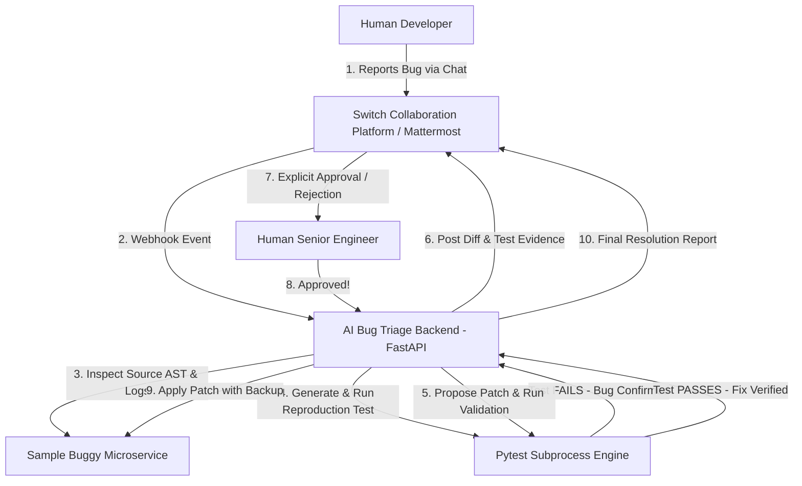

# AI Bug Triage & Resolution Team 🤖🛠️

[](https://www.wemakedevs.org/hackathons/switch)
[](#)
[](https://www.python.org/)
[](https://fastapi.tiangolo.com/)
[](https://docs.switchagents.ai/)
[-brightgreen)](#)

> **Submission for Flip the Switch Hackathon (Track: Best Business Workflow)**
> An end-to-end, real AI-powered bug investigation, test-driven reproduction, and patch generation system centered around the **Switch** team collaboration platform with strict **Human-In-The-Loop (HITL)** approval controls.

---

## 📌 Executive Summary & Business Workflow

In modern software engineering organizations, critical bug resolution suffers from context switching, missing test reproduction, unverified fixes, and risky automated deployments. 

**AI Bug Triage & Resolution Team** establishes an enterprise business workflow inside **Switch**:
1. 🧑‍💻 **Developer Reports Bug** in a Switch team chat room (`#ai-bug-triage`).
2. 🤖 **AI Bug Investigator** is assigned automatically via Switch collaboration events.
3. 🔬 **Source Code & Log Inspection**: The agent examines real application ASTs and server logs to deduce root causes.
4. 🧪 **Reproduction Test Generation**: Creates automated `pytest` suites and verifies a **FAIL** on the original code (confirming defect reality).
5. 🛠️ **Patch Generation & Pre-Validation**: Synthesizes minimal surgical code fixes, running tests with a temporary in-memory patch to guarantee **PASS**.
6. 🛡️ **Human Approval Gate (Safety Guarantee)**: Patches **CANNOT** be merged or applied automatically. A Senior Engineer must explicitly review the diff and approve in Switch.
7. 🚀 **Safe Patch Application & Resolution**: Backups are created, approved changes are applied, and a final resolution report is broadcast back into Switch.

---

## 🏛️ System Architecture



---

## ⚡ Quick Start & Running the Project

### 1. Requirements
- Python 3.12+
- Git

### 2. Installation
```powershell
# Clone or navigate to the directory
cd C:\Users\LENOVO\Desktop\FlipTheSwitchHackathon

# Install dependencies
pip install -r requirements.txt
```

### 3. Start the Backend Server
```powershell
python start.py
```
*API Documentation will be live at `http://127.0.0.1:8000/docs`*

### 4. Run the Full Interactive Workflow Demo
In a separate terminal:
```powershell
python demo/run_demo.py
```

### 5. Run the Automated Test Suite (100% Passing)
```powershell
python -m pytest tests/ -v
```

### 6. Verify Live Integration Readiness
```powershell
python -m scripts.switch_preflight
```
The command is non-destructive. It checks for a configured OpenAI key, Switch agent credentials, and a healthy Switch bridge before any live workflow is attempted.

---

## 🧪 Real Evidence & Test Execution

Unlike mock demonstrations, this project executes real code inspections and real `pytest` subprocess runs:

- **Bug 1 (Calculator Precision)**: Integer floor division `//` in `calculator.py` causing loss of precision on fractional metrics.
- **Bug 2 (Inventory Value)**: Loop overwrite `total = ...` instead of accumulating `total += ...` in `inventory.py`.
- **Unit & Integration Suite**: 6 tests covering workflow persistence, source diagnosis, reproduction failure, isolated patch validation, approval/rejection, stale approval, duplicate webhook events, and path safety.

---

## 🔒 Security & Safety Controls
- **Zero Automatic Deployments**: Attempting to call `/api/bugs/{id}/patches/{id}/apply` without human approval returns HTTP 400 Bad Request.
- **Automated Timestamped Backups**: Original source files are backed up to `.backup_<timestamp>` before applying any changes.
- **Audit Trails**: Full timestamps, reviewer identities, diffs, and execution logs persisted in SQLite / PostgreSQL.

---

## 🤝 Switch Centrality
If Switch is removed, the collaborative workflow breaks: Switch provides the shared room infrastructure, webhook event triggers, human approval requests, and resolution broadcasts that bridge human teams with autonomous AI agents.

## Submission Material

Use [docs/submission_draft.md](docs/submission_draft.md) to paste accurate project details into the hackathon form after adding the public repository and demo video URLs.
