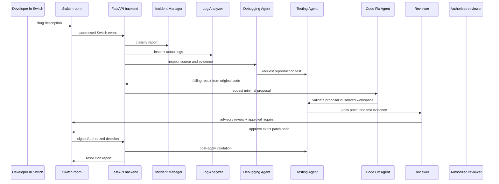

# Multi-Agent Workflow

## Roles and safety boundaries

| Role | Does | Cannot do |
|---|---|---|
| Incident Manager | Classifies and coordinates state | Apply a patch |
| Log Analyzer | Reads configured application logs | Invent log evidence |
| Debugging Agent | Connects source evidence to the failure | Claim an LLM result without a provider response |
| Testing Agent | Generates/runs reproduction and validation tests | Mark a process error as a passing test |
| Code Fix Agent | Proposes minimal diffs | Write source files |
| Reviewer | Supplies an advisory risk review | Approve or apply its own patch |
| Human reviewer | Approves/rejects a hash-bound patch through Switch | Bypass validation or authorization checks |

All agent outputs are structured and retained in workflow history. A missing LLM credential creates a `blocked` outcome; it never falls back to fabricated AI text.
